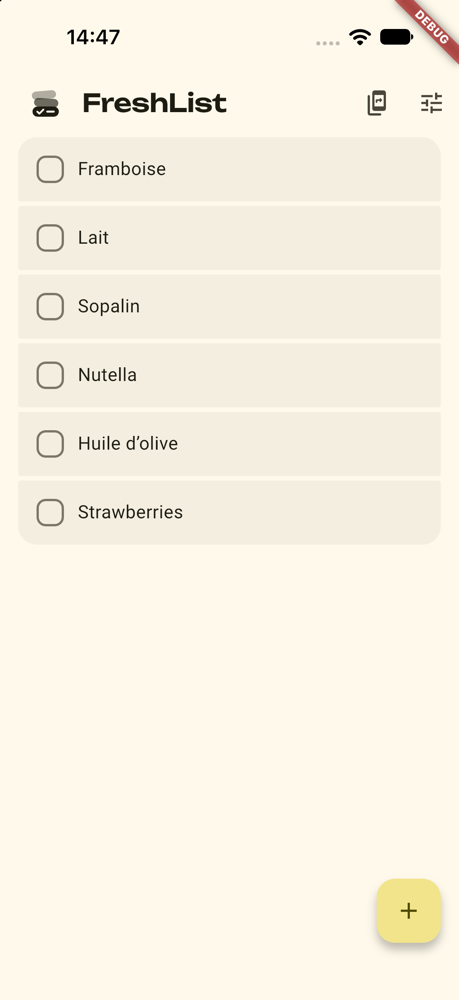
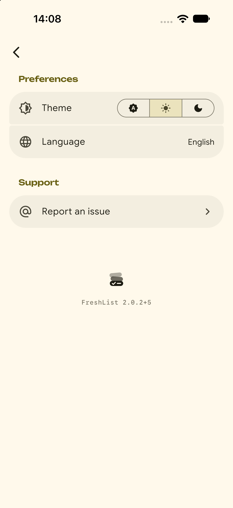
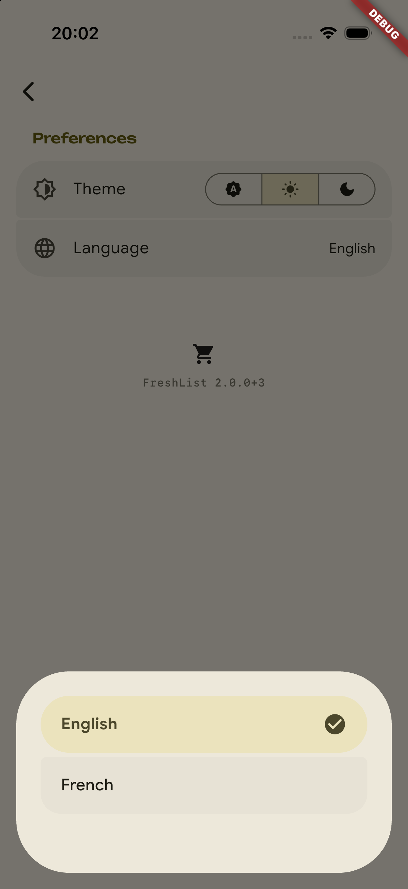
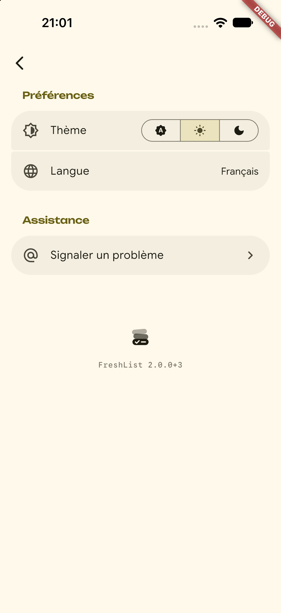

# FreshList

A Flutter application to manage your grocery list.

## Screenshots

| Home | Add an entry | Settings |
| --- | --- | --- |
|  |  |  |

| Language switcher | French | Dark theme |
| --- | --- | --- |
|  |  |  |

The screenshots are generated with Flutter Driver on a booted iOS simulator:

```sh
flutter drive \
  --driver=test_driver/screenshots.dart \
  --target=test_driver/app.dart \
  -d <simulator id>
```

## TODO

* Native launcher icon & splash screen
* Improve Material 3 Expressive UI
* Sharing with [Nearby Connections](https://developers.google.com/nearby/connections/overview)
* Sharing with local HTTP server 
