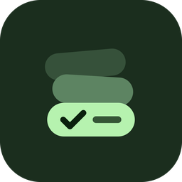
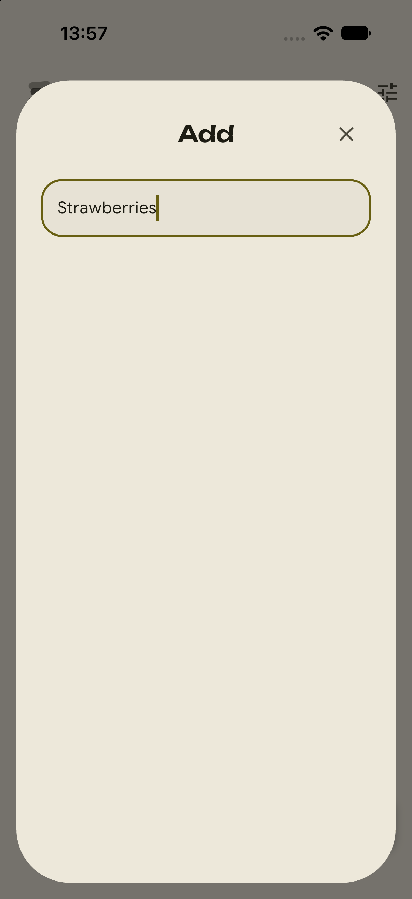
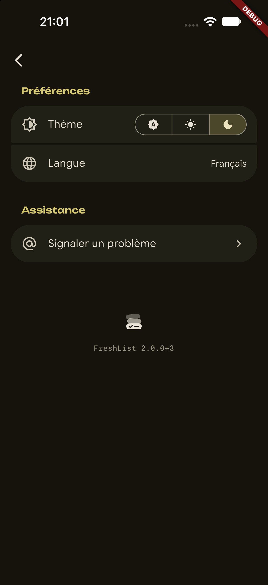

<p align="center">
  
</p>

<h1 align="center">FreshList</h1>

<p align="center">A Flutter application to manage your grocery list.</p>

<p align="center">
  
  <a href="https://github.com/TesteurManiak/fresh_list/actions/workflows/release-apk.yml"></a>
</p>

## Screenshots

| Home | Add an entry | Settings |
| --- | --- | --- |
|  |  |  |

| Language switcher | French | Dark theme |
| --- | --- | --- |
|  |  |  |

The screenshots are generated with Flutter Driver on a booted iOS simulator:

```sh
flutter drive \
  --driver=test_driver/screenshots.dart \
  --target=test_driver/app.dart \
  -d <simulator id>
```

## Generate localizations

```sh
flutter gen-l10n
```

## Precompile SVGs

```sh
dart run vector_graphics_compiler \
  --input-dir assets/icons/svg/raw \
  --out-dir assets/icons/svg/precompiled
```

Then run `build_runner` to generate the appropriate accessors.

## TODOs

* Improve Material 3 Expressive UI
  - Add/Edit entry sheet
* Manage multiple lists
* Collaborative list edition with [Nearby Connections](https://developers.google.com/nearby/connections/overview)
* In-app updates

## Credits

* [Expressive components](https://github.com/kamranbekirovyz/bunpod/tree/main/packages) from [Kamran Bekirov](https://github.com/kamranbekirovyz)

